# Project Aether

**A rocket launch simulator that runs in the browser, built on real physics instead of canned animation.**

### ▶ [Launch it in your browser](https://kylesau.github.io/project-aether/)

Works on phones and desktops. Uses WebGPU where available and falls back to WebGL2. Nothing to install.

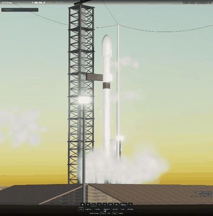

---

## Objective

Build a launch simulator where **every motion on screen comes from a physics solver**, then render it as well as a browser allows.

The project had three rules:

1. **The vehicle never follows a scripted path.** A 6-DOF rigid-body integrator moves the rocket every frame. It includes thrust, gravity, aerodynamics, mass depletion and closed-loop guidance.
2. **The solvers must be ones that actually ran.** Engine performance comes from Cantera chemical equilibrium. The trajectory is cross-checked against SciPy `solve_ivp`. The browser integrator is checked against both.
3. **Each visual is labelled by how much to trust it.** Every element is tagged **SOLVER DATA**, **REDUCED-ORDER MODEL** or **ARTISTIC**. A CFD adapter exists but is labelled **NOT CONNECTED** because OpenFOAM has never been run here.

## Results at a glance

| | |
|---|---|
| **Mission** | Two-stage LOX/RP-1 launch vehicle (generic, unbranded), launched due east from 28.5° N |
| **Orbit reached** | **196.6 × 203.4 km**, inclination 28.64°, e = 0.0005 |
| **Key events** | Max-Q 31.3 kPa at T+51 s (Mach 1.07) · MECO T+151.8 s · SECO T+460.1 s |
| **Engine chemistry** | Cantera matches Sutton & Biblarz Table 5-5 within 0.3 % on T<sub>c</sub>, c\* and Isp |
| **Browser vs reference** | TypeScript RK4 lands within **0.84 m** of SciPy after a 763 s flight |
| **Tests** | 35 pytest · 15 vitest · 1 cargo, all passing |
| **Frame rate** | 117–131 fps on desktop (RTX 4070 Ti); the low-quality tier is the one meant for phones |

## Screenshots

| Pad at dawn | Lift-off |
|---|---|
| 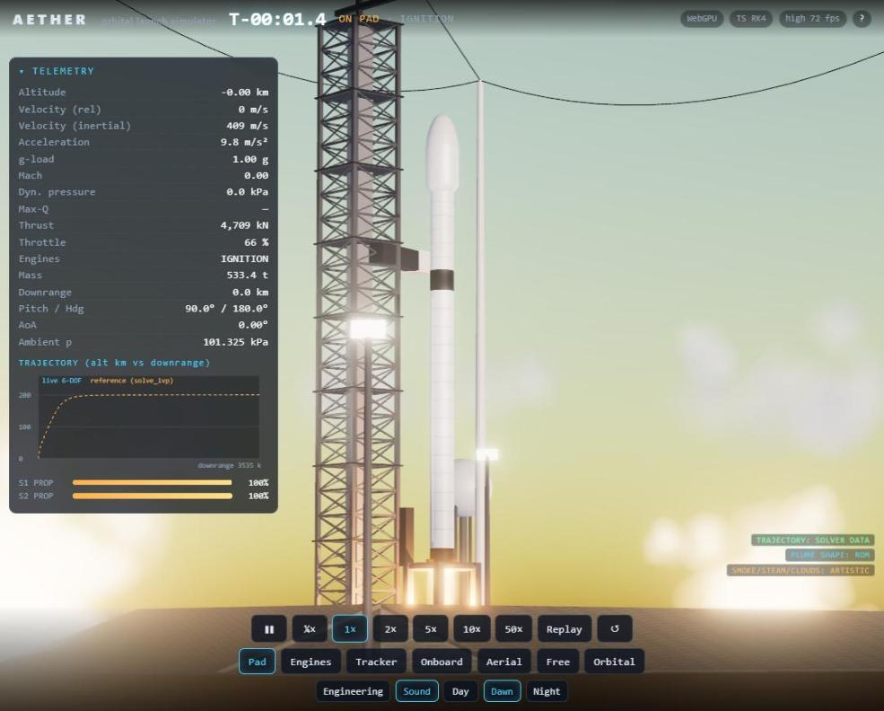 | 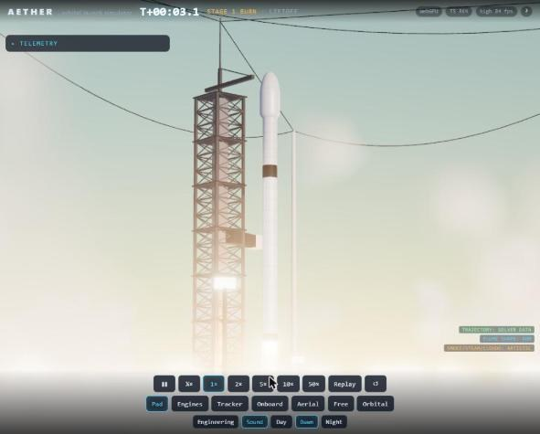 |
| **Engineering overlays** (CG/CP, thrust vector, plume model, Cantera data) | **Orbit achieved** |
| 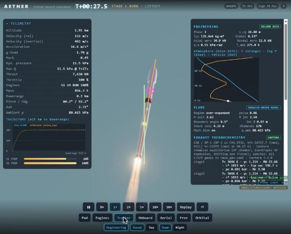 | 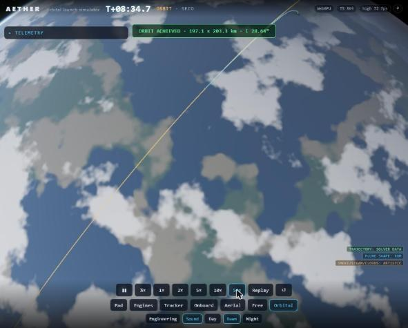 |

There are **7 cameras**: Pad, Engines, Tracker, Onboard, Aerial, Free and Orbital. The other controls are:
- time warp from ½× to 50×, plus replay;
- day, dawn and night lighting;
- an engineering mode that draws forces, CG and CP, the atmosphere profile, the plume model and the exhaust thermochemistry.

## The physics

### Ascent trajectory

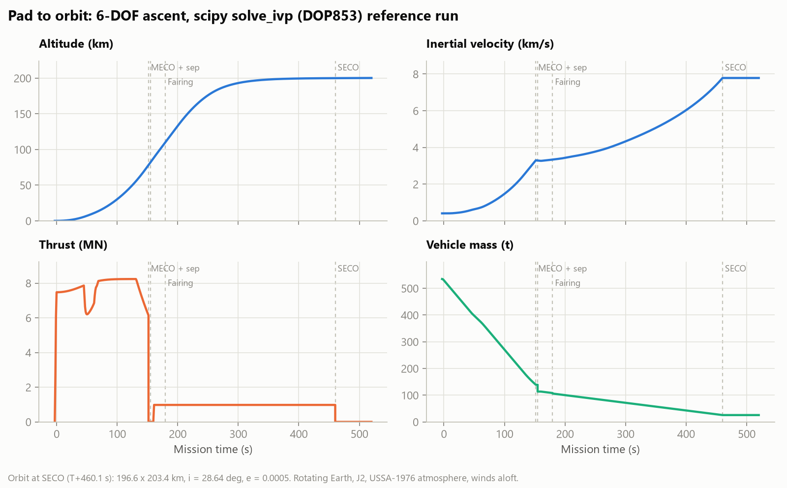

The flight model has 15 states: position, velocity, attitude quaternion, body rates and the propellant mass of each stage. It includes:

- **Gravity:** point mass plus **J2** (Earth's oblateness).
- **Earth model:** rotating Earth, so the launch site has 409 m/s of inertial velocity at T-0.
- **Atmosphere:** **USSA-1976**, with a winds-aloft profile.
- **Thrust:** pressure-corrected, `F = ṁ·vₑ + (pₑ − p_amb)·Aₑ`. Thrust rises with altitude as ambient pressure falls.
- **Aerodynamics:** axial and normal force from a Mach table. The aerodynamic moment acts about the live CG, which moves as the tanks drain.
- **Steering:** gimballed thrust-vector control driven by a gravity-turn ascent law.
- **Stage 2 guidance:** a closed-loop altitude and flight-path controller that shuts the engine down at the target orbital energy.

### Max-Q and the throttle bucket

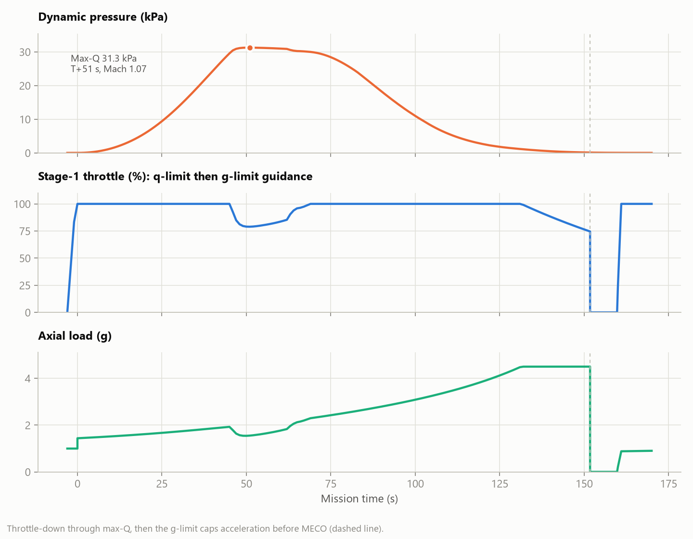

Throttle is set by guidance, not by a script:
- It drops through max-Q to hold dynamic pressure near its limit.
- Later the g-limit caps acceleration as the stage gets lighter.

### Engine thermochemistry (Cantera 3.2.0)

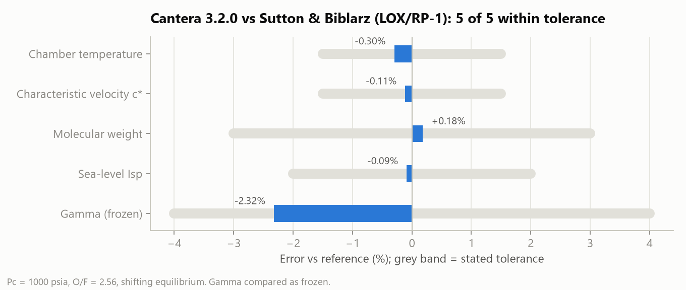

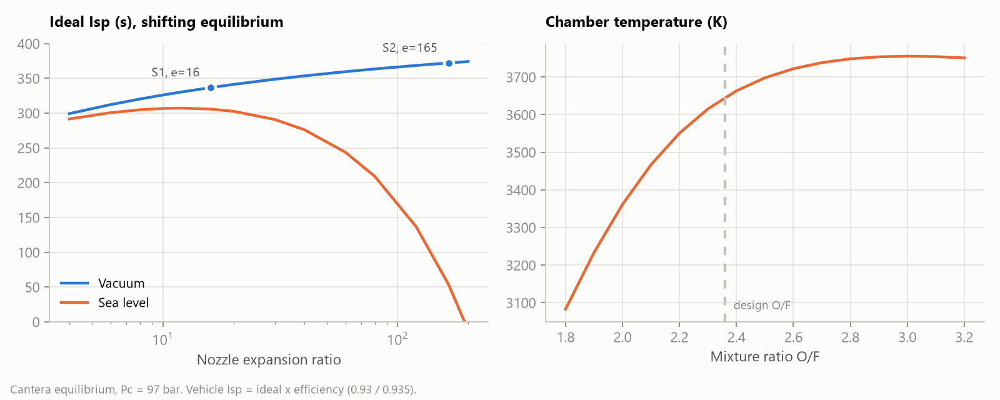

The chamber is solved by HP chemical equilibrium, then expanded isentropically to the nozzle exit (shifting and frozen). The results set each stage's exhaust velocity and exit pressure:
- Stage 1: ε = 16
- Stage 2: ε = 165

### Plume (reduced-order model, **not CFD**)

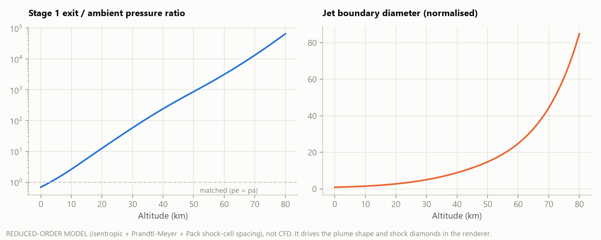

The plume shape changes with altitude: over-expanded at sea level, close to matched at a few km, then strongly under-expanded and widening. The model behind it:
- isentropic nozzle relations;
- the Prandtl–Meyer turning angle at the jet boundary;
- Pack's shock-cell spacing for the shock diamonds.

The renderer uses this model, so the plume reacts to the simulated ambient pressure. Plume colour and luminosity are artistic.

### Aerothermal estimate

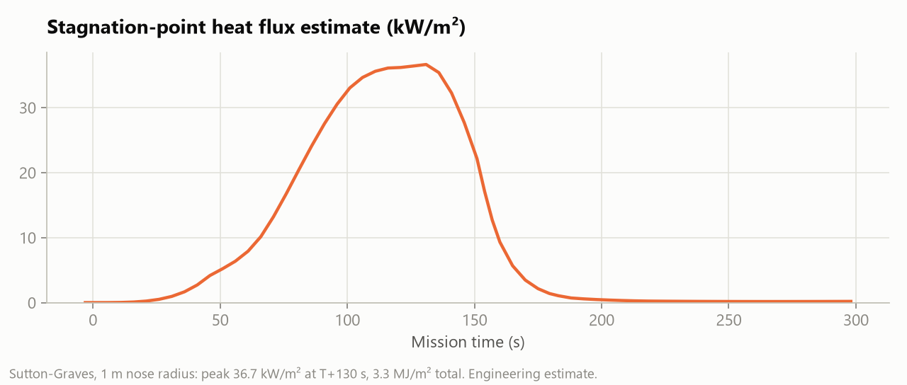

### Performance: TypeScript vs Rust/WASM

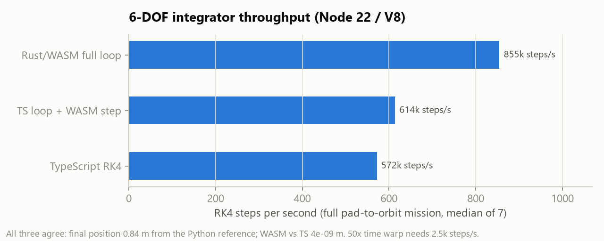

The integrator exists three times, kept line-for-line identical:

| Version | Used for |
|---|---|
| Python (`physics/aether_physics`) | the reference |
| TypeScript | the browser default |
| Rust compiled to WebAssembly | an option, `?physics=wasm` |

TypeScript already runs about 229× faster than 50× warp needs, so WASM stays optional.

## Trust labels

| Label | What it covers |
|---|---|
| **SOLVER DATA** | Trajectory, attitude, staging events, thrust, mass, Mach, q, orbit elements, Cantera chamber/exit states |
| **REDUCED-ORDER MODEL** | Plume shape, shock-cell spacing, Mach disk, stagnation heating, spent-stage and fairing ballistics (3-DOF) |
| **ARTISTIC** | Plume colour and glow, smoke, steam, clouds, vapour cone, procedural Earth, camera shake, audio |
| **NOT CONNECTED** | OpenFOAM `rhoCentralFoam` adapter. A wedge case generator exists; **no CFD has been run, and no CFD output is shown** |

## Running locally

```powershell
# Windows: builds the frontend, runs the Cantera/SciPy precompute, serves app + API on :8300
.\start.ps1
```

Or serve just the static build: `python -m http.server -d site 8080`.

Run the tests:

```bash
pytest physics/tests backend        # 35 tests
cd frontend && npx vitest run       # 15 tests
cd wasm && cargo test               # 1 test
```

Rebuild the README figures with `python docs/figures/make_figures.py`. They are generated from the solver outputs in `site/data/`.

## Repository layout

```
physics/    Python 6-DOF reference model, atmosphere, Cantera thermo, plume ROM + tests
backend/    FastAPI app, offline precompute, OpenFOAM case generator/adapter (not connected)
frontend/   Vite + React + three.js (three/webgpu + TSL) renderer and the TS physics port
wasm/       Rust port of the integrator (wasm-bindgen)
site/       Static build, published to GitHub Pages
docs/       AETHER.md (model details, validation, benchmarks, limitations), figures
```

Full model description, validation table and limitations: **[docs/AETHER.md](docs/AETHER.md)**.

## Limitations

- **Not tested on a real phone.** The phone layout and quality tier were only checked in a 400 px desktop view.
- **No CFD.** OpenFOAM is not installed. Running it needs WSL2 Ubuntu or Docker.
- **Simplified guidance and control.** Stage 2 guidance is planar. There is no roll control and no actuator dynamics.
- **Simplified upper atmosphere.** Above 86 km it is interpolated from the 1976 tables.
- **Rendering shortcuts.** Particles are not depth-sorted, and the sun direction is fixed relative to the pad.

## Credits

- Textures: [Poly Haven](https://polyhaven.com) (CC0).
- Thermochemistry: [Cantera](https://cantera.org).
- Rendering: [three.js](https://threejs.org).
- Reference data: Sutton & Biblarz, *Rocket Propulsion Elements*, Table 5-5.
- Companion project: [Project Levitate](https://github.com/KyleSau/project-levitate).
